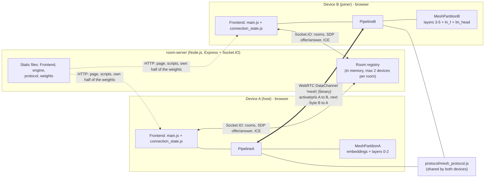
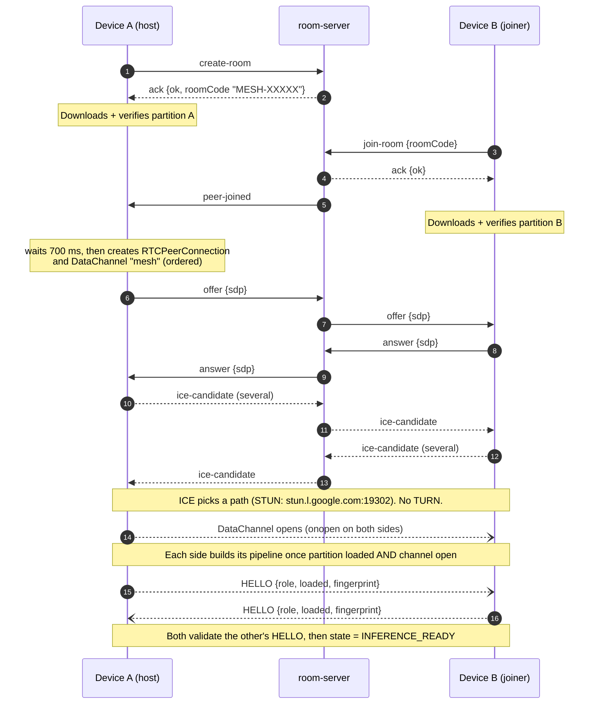
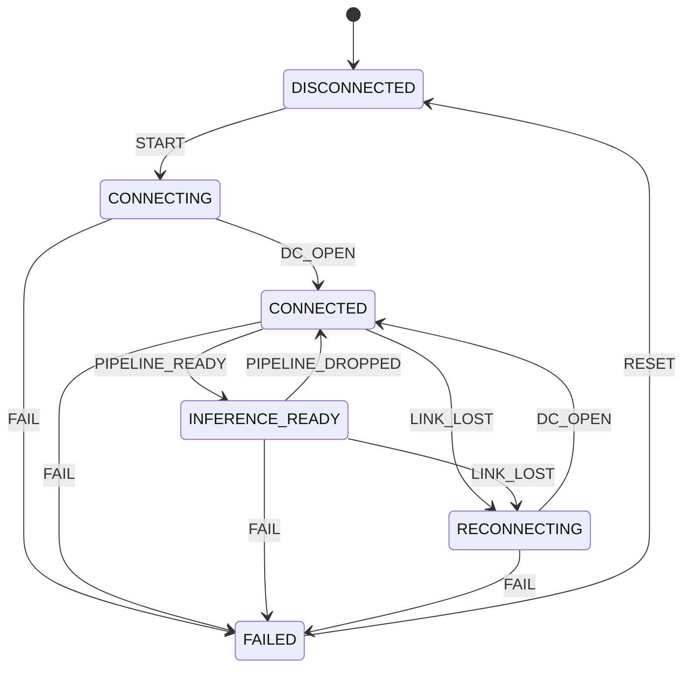
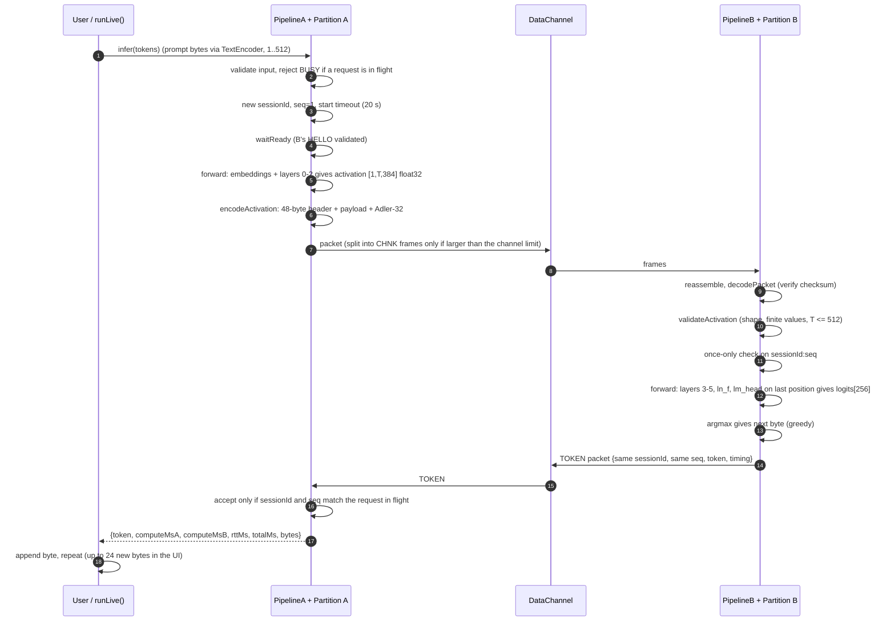
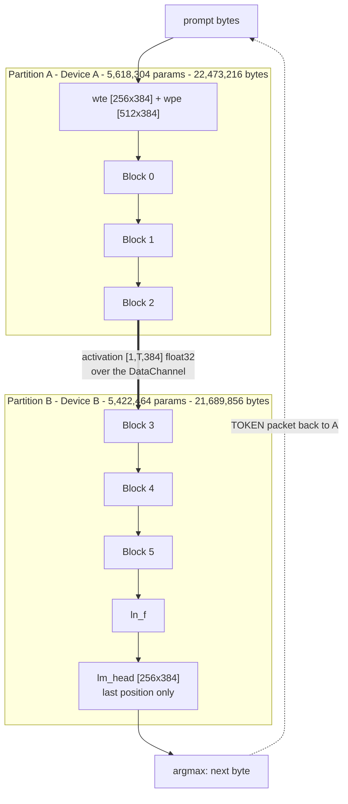
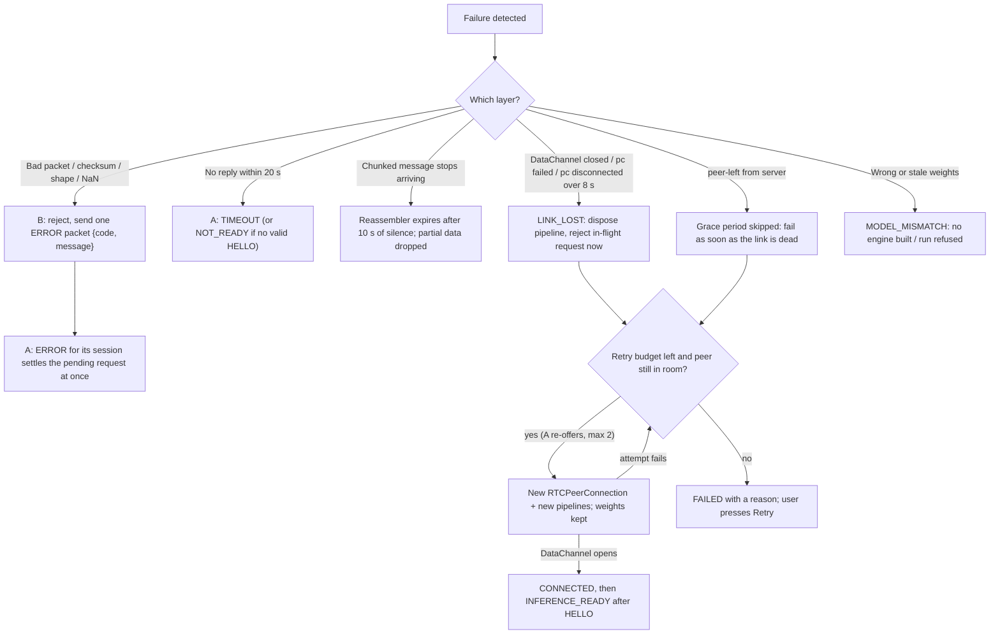

# MINIMOL — Architecture

This document describes the system **as implemented** (code at the time of Stage 8). Where something is a design intention rather than something tested, it says so. For evidence levels see [TESTING.md](TESTING.md) and [BENCHMARKS.md](BENCHMARKS.md).

> **Naming.** The project is called MINIMOL. The wire protocol was built under the working name MESH, so the packet magic bytes (`"MESH"`, `0x4D455348`), room codes (`MESH-XXXXX`) and some identifiers (`MeshPipeline`, `mesh_protocol.js`, the DataChannel label `"mesh"`) keep that name. Renaming them would change the wire format, so they were left alone.

Contents: [1 System](#1-system-architecture) · [2 Connection lifecycle](#2-connection-lifecycle) · [3 Inference lifecycle](#3-inference-lifecycle) · [4 Model partitioning](#4-model-partitioning) · [5 Binary protocol](#5-binary-protocol) · [6 Error handling](#6-error-handling-and-recovery) · [7 Design decisions](#7-design-decisions-and-trade-offs) · [8 Limits](#8-known-limits)

---

## 1. System architecture

Two browsers each hold **half of one small transformer**. A Node.js server helps them find each other, then plays no further part. The computation crosses between them as one binary message per generated byte.



| Component | Files | Responsibility | Talks to |
|---|---|---|---|
| **Frontend** | `Frontend/main.html`, `main.js`, `main.css` | UI, weight download and verification, WebRTC set-up, connection recovery, wiring the pipeline to the DataChannel | room-server (Socket.IO, HTTP), peer (WebRTC) |
| **Connection state machine** | `Frontend/connection_state.js` | One authoritative connection state; refuses impossible transitions | `main.js` only (pure logic, also unit-tested in Node) |
| **Signalling server** | `room-server/server.js` | Create/join rooms, relay SDP and ICE to the *other* device, announce `peer-joined` / `peer-left`, serve static files | Both browsers |
| **Pipeline** | `engine/mesh_pipeline.js` | Request/response coordination: HELLO model handshake, session/sequence matching, once-only processing on B, chunked send, timeouts, `dispose()` | Protocol + engine; given a `{send, maxMessageSize}` transport |
| **Inference engine** | `engine/inference_engine.js` | The transformer maths in plain `Float32Array` JavaScript (no WebGL/WebGPU/WASM) | Nothing: no networking |
| **Protocol** | `protocol/mesh_protocol.js` | Packet encode/decode, tensor serialization, checksum, validation, chunking/reassembly | Nothing: pure functions and classes |
| **Model + export** | `model/transformer.py`, `export_weights.py`, `verify_reference.py` | PyTorch + NumPy reference model; writes weight files and manifest | Filesystem |

**Why the engine, protocol and pipeline are separate files.** Each can be tested without a network: `test_protocol.js` needs no model, `test_js_engine.js` needs no protocol, and the pipeline accepts any `{send, maxMessageSize}` object, so the same code runs over a real `RTCDataChannel` in a browser and over a simulated link in Node tests. The cost is a little indirection (`transport` objects, `handleMessage`).

**What the server does *not* do.** It never carries activations or tokens and does no inference. It serves the weight files as static downloads. Its room state is a `Map` in memory; restarting it forgets all rooms.

---

## 2. Connection lifecycle

### 2.1 Establishing the connection



Details worth knowing:

- **Server-side authority.** The server decides which room a signal belongs to from its own record of the sender's socket, not from any field the client sends. A signal from a socket in no room, or with the wrong SDP `type`, is dropped (tested in `room-server/test/signalling.test.mjs`).
- **Early ICE candidates.** A candidate can arrive before the offer/answer has been applied; `main.js` buffers it and applies it afterwards (`flushIce`).
- **Why two readiness conditions.** Weights (a ~21 MB download plus a checksum) and the channel finish in either order. `maybeInitPipeline()` runs when *both* are true, exactly once.
- **Signalling is only a rendezvous.** After the channel opens, the Socket.IO connection carries nothing for inference.

### 2.2 Connection states

One state variable replaces what were originally five loosely related flags. An event with no arrow from the current state is refused rather than applied.



(`CANCEL` and `RESET` return any non-failed state to `DISCONNECTED`; they are omitted from the diagram for readability. The full table is `TRANSITIONS` in `connection_state.js`.)

### 2.3 Disconnection and cleanup

- **What counts as "link lost":** DataChannel `close`; peer connection `failed`; or peer connection `disconnected` for longer than 8 s (immediately if signalling already reported `peer-left`).
- **Recovery:** Device A re-offers up to 2 more times (1 s, then 2 s backoff, 15 s per attempt); Device B waits up to 20 s per attempt. Afterwards the state is `FAILED` with a reason. The retry budget refills only after a *completed inference*, because "reconnected" is not the same as "working".
- **Signalling loss:** Socket.IO auto-reconnect is turned off, because a reconnected socket would be in no room. Losing signalling *before* the DataChannel exists fails the session. Losing it *after* lets inference continue but makes reconnection impossible.
- **Server side:** when a member's socket disconnects, the server emits `peer-left` to the other device and **closes the room**, so a half-empty room cannot be joined by a third device.
- **Cleanup is idempotent and ordered:** `closePeer()` (peer connection, DataChannel, pipeline, timers, ICE buffer) and `teardown()` (also the socket). Handlers are detached *before* `close()` so our own close does not trigger our own failure path.
- **Generations.** `closePeer()` increments `S.gen`. Every callback captures the generation it was created in and returns if it is stale, so a late event from an old connection cannot touch a new one.

---

## 3. Inference lifecycle

One request computes **one next byte**. Text generation is a loop in `main.js` (`runLive`) that calls `PipelineA.infer()` again with the longer sequence. There is **no KV cache**: every step recomputes the whole sequence on both devices.



Notes grounded in the code:

- **Sizes.** The activation is `[1, T, 384]` float32 = `1536·T` bytes; the packet is `48 + 1536·T` bytes (12,336 B at T=8; 786,480 B at T=512, which needs 4 frames at the 262,144-byte limit Chromium reported). The reply is a small JSON token packet.
- **Tokenization.** "Tokens" are raw UTF-8 bytes (vocabulary 256). There is no tokenizer file.
- **Sampling.** Greedy argmax only (temperature 0). The model's weights are **random**, so the output is deterministic but meaningless text; see [Limits](#8-known-limits).
- **Logits on request.** Validation runs can set `FLAG_WANT_LOGITS` so B returns all 256 logits, which A checks against the returned byte.
- **Numerical correctness.** The same partition code runs locally and distributed (bit-identical logits, tested). Against PyTorch the maximum observed difference is ~1.1e-6 (tolerance 1e-5); the argmax matched on all reference cases. It is *not* bit-for-bit equal to PyTorch.

---

## 4. Model partitioning

### 4.1 The model

A GPT-style causal decoder over bytes: vocabulary 256, context 512, 6 layers, `d_model` 384, 6 heads (64 each), feed-forward 1536 (GELU, tanh approximation), pre-LayerNorm (ε = 1e-5), learned positional embeddings, untied output head. **11,040,768 parameters**, float32. Initialised from seed 42 (`N(0, 0.02)` weights, zero biases, unit LayerNorm gains) and **never trained**.



The cut is after block 2. Because the boundary is the residual stream, "A then B" is mathematically the same function as the full model (tested: PyTorch full == PyTorch split with max difference 0.0; JS distributed == JS local bit-for-bit). The cut position is hard-coded in the engine (`SPLIT_AFTER_LAYER = 2`) and included in the fingerprint.

### 4.2 Weight files and the manifest

`python model/export_weights.py` writes to `room-server/public/weights/`:

| File | Content | Size |
|---|---|---|
| `partition_a.bin` | raw float32, tensors packed back-to-back | 22,473,216 B |
| `partition_b.bin` | same | 21,689,856 B |
| `full_model.bin` | all tensors (used by the reference/local path) | 44,163,072 B |
| `weights_manifest.json` | architecture, per-tensor `shape` / `byte_offset` / `byte_length`, and `checksum_adler32` per `.bin` | ~47 KB |

The browser maps each tensor as a `Float32Array` view into the downloaded buffer. Each device downloads **only its own** partition. (Sizes in these docs are decimal bytes unless "MiB" is written: 22,473,216 B is 21.43 MiB.)

### 4.3 Fingerprinting and compatibility checks

1. **At load time** each device checks its downloaded partition's byte length and Adler-32 against the manifest (`verifyPartitionBuffer`). A mismatch throws `MODEL_MISMATCH` and no engine is built.
2. **At connection time** each device sends `HELLO {role, loaded, fingerprint}`. The fingerprint is a string of the architecture, dimensions, seed, parameter count, the cut position and the Adler-32 of **both** partitions. A device refuses to run if the peer's fingerprint differs, if the peer claims the same role, or if the peer has not loaded its partition (the last case is retried until timeout, the first two are fatal).

> Adler-32 detects accidental corruption and stale files. It is **not** a cryptographic hash and gives no protection against a malicious peer.

---

## 5. Binary protocol

Everything on the DataChannel is binary (`binaryType = "arraybuffer"`); the channel is created `ordered: true` (reliable, in-order).

```
 byte 0..3    Magic "MESH" (0x4D455348)
 byte 4       Version (0x01)
 byte 5       Message type: 0x01 ACTIVATION, 0x02 TOKEN, 0x03 CONTROL, 0x04 ERROR, 0x05 TENSOR
 byte 6..7    Flags  (ACTIVATION: 0x0002 = "send logits back"; TOKEN: bit 0 = EOS)
 byte 8..15   Session ID (uint64)
 byte 16..19  Sequence number (uint32)
 byte 20      Data type (0x01 float32 for tensors; 0x04 UTF-8 JSON for control/token/error)
 byte 21      Tensor rank (0..4)
 byte 22..23  Reserved
 byte 24..39  Dimensions: 4 x uint32 (unused slots 0)
 byte 40..43  Payload length (uint32)
 byte 44..47  Adler-32 of the payload
 byte 48..    Payload
```

All multi-byte header fields are big-endian. Tensor payloads are raw typed-array memory and therefore little-endian; the code refuses to run on a big-endian host rather than silently mis-decode.

- **ACTIVATION / TENSOR**: float32 tensor payload. **TOKEN / CONTROL / ERROR**: JSON payload. In the live pipeline the only CONTROL command used is `HELLO` (the test suite also exercises `START_GENERATION`).
- **Chunking.** If a packet exceeds the channel's negotiated `sctp.maxMessageSize`, `splitIntoChunks` cuts it into frames with a 20-byte header (`"CHNK"`, messageId, index, count, total). `ChunkReassembler` rebuilds the exact original bytes, then the normal packet checks run. Reassembly is capped at 8 MiB.
- **Backpressure.** The frontend transport waits for `bufferedamountlow` while more than 1 MiB is queued (resumes at 256 KiB).

---

## 6. Error handling and recovery

Failures are *independent*: Socket.IO can be up while the DataChannel is dead, and either device can vanish at any time. Each is detected where it happens, converted to a `MeshError` with a code, and settled into a rejected promise instead of a hang.



| Failure | Detection | Behaviour (code in `engine/mesh_pipeline.js` unless noted) |
|---|---|---|
| Corrupted or truncated packet | magic, length and Adler-32 checks in `decodePacket` | `BAD_PACKET` / `CHECKSUM`; B answers with an ERROR packet |
| Wrong shape, NaN/Infinity activation, T > 512 | `validateActivation` before any compute | `BAD_SHAPE` / `NON_FINITE` / `TOO_LARGE` |
| Duplicate activation delivery | `sessionId:seq` seen-set on B | `DUPLICATE`, not recomputed |
| Late or duplicate reply on A | reply must match the request in flight on `sessionId` and `seq` | ignored with a warning |
| Second request while one is running | `pending` slot on A | `BUSY` |
| B's compute throws | try/catch around `forward` | `COMPUTE_FAILED` sent to A immediately |
| Peer has different weights | fingerprint in HELLO; checksum at load | `MODEL_MISMATCH` |
| Peer never answers | per-request timer (default 20 s), cleared on settle | `TIMEOUT` / `NOT_READY` |
| Half-received chunked message | inactivity timer (10 s) | message discarded; `stats.expired` |
| DataChannel closes mid-request | `dispose()` | request rejected immediately with `CHANNEL_CLOSED` (browser run: 36 ms) |
| Peer's tab closed | `peer-left` + channel failure | A reaches `FAILED` in a few seconds, with the reason shown |

**Known gap (L1 in `docs/history/STAGE6_STATUS.md`).** B's ERROR packet for a message it could not reassemble cannot carry that message's session ID, so A matches it to whatever request is pending. A stray ERROR from an old broken transfer that arrives after its request timed out can fail the *next* request once. It is reported, not silent, and a retry works. Fixing it needs a protocol change.

---

## 7. Design decisions and trade-offs

| Decision | Why | Alternatives considered | Cost / limitation |
|---|---|---|---|
| **Pipeline split across two devices** | Each device holds ~half the weights (21.4 + 20.7 MiB instead of 42.1 MiB) | One device runs everything (faster, simpler) | One request runs A then B sequentially, so latency is never lower than local ([BENCHMARKS.md](BENCHMARKS.md)) |
| **WebRTC DataChannel for tensors** | Direct device-to-device path; no server in the data path; binary and reliable | Relay through Socket.IO (simpler, no NAT problems, but server carries all traffic) | Needs ICE; no TURN here, so some networks cannot connect |
| **Socket.IO only for signalling** | Rooms, acks and reconnection semantics out of the box | Raw WebSocket (fewer dependencies, more to write) | One more dependency; auto-reconnect deliberately disabled |
| **Custom 48-byte binary header** | Tensors stay raw bytes (no JSON/base64 inflation); self-describing shape; checksum | JSON or base64 (simple, ~33% larger for base64), protobuf/flatbuffers (new dependency) | Hand-written code to maintain and test |
| **Float32 on the wire** | Exactly what the engine computes with: no quantization error | fp16 / int8 (smaller, but changes numerics) | Larger transfers; not a bottleneck at these sizes |
| **Plain JavaScript engine** | Runs anywhere a browser does; easy to test bit-for-bit | WASM / WebGPU / ONNX Runtime Web (faster) | Slow; main thread, so the UI freezes during inference |
| **Adler-32 checksum** | Cheap, matches `zlib.adler32` on the Python side | CRC32 / SHA-256 | Weaker; ~130x slower than memcpy in JS, but under 1% of a request |
| **No KV cache** | Keeps the engine contract trivial: stateless request, easy to validate | KV cache (the largest remaining speed-up) | Every token recomputes the whole sequence; attention grows with T² |
| **New peer connection on reconnect (no ICE restart)** | Simplest correct recovery: fresh pipelines, no stale state | ICE restart (faster) | ~1 s on one machine; real networks untested |

*"Alternatives considered" lists the realistic options for each choice; the project history does not record that each was formally evaluated.*

---

## 8. Known limits

- **The model is untrained.** Output is deterministic but meaningless (e.g. prompt `MESH` → `MESHääääääbbðb`). The project demonstrates *distributed computation*, not language ability.
- **Tested environments.** Node simulations, and headless Chromium with two pages on one machine. **Not tested:** two physical devices, Safari, Firefox, mobile browsers, real networks. See [TESTING.md](TESTING.md) for the evidence table.
- **No TURN server.** Devices behind symmetric or strict NAT may never connect. The only configured ICE server is Google's public STUN.
- **Main-thread compute.** The page is unresponsive while a long prompt is processed.
- **Security model.** No authentication and no rate limiting on the server; WebRTC itself encrypts the DataChannel (DTLS). Room codes are 5 characters from a 32-character alphabet (about 33 million combinations); they are a convenience, not a secret. Intended for trusted LAN/demo use.
- **No real-network measurements.** All timings are same-machine ([BENCHMARKS.md](BENCHMARKS.md)).
