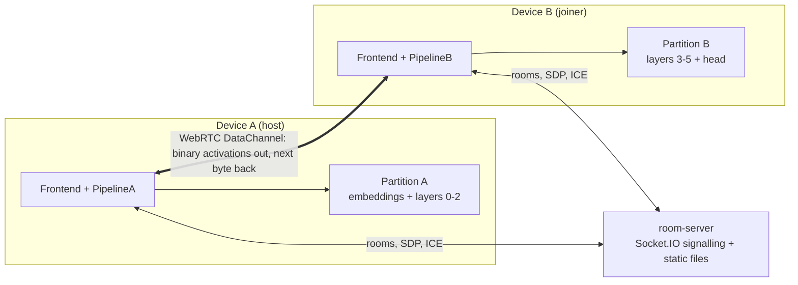

# MINIMOL

**A browser-based distributed inference experiment: one small transformer, split across two connected devices, with the intermediate activations sent directly between them over a WebRTC DataChannel.**

Two browsers pair through a tiny Node.js signalling server, each downloads *half* of an 11-million-parameter byte-level GPT model, and a text prompt is processed by Device A (embeddings + layers 0–2) → a binary tensor packet over the DataChannel → Device B (layers 3–5 + output head) → the next byte comes back. Repeat per generated byte.

> **Honest status.** The model is **randomly initialised and untrained**, so the generated text is meaningless. The project demonstrates the *systems engineering* (signalling, WebRTC, a binary tensor protocol, partitioned inference, failure handling, measurement), not language ability. It has been tested with Node simulations, a signalling test suite, and **headless Chromium on one machine**. **It has not been tested on two physical devices, other browsers, or across different networks.** Distributed inference here is **not faster** than running locally (see [Benchmarks](#benchmark-summary)); the point is the split, not the speed.

## Table of contents

[Why](#why-this-project) · [Features](#features) · [Architecture](#architecture-overview) · [Tech stack](#technology-stack) · [Quick start](#quick-start) · [Usage](#usage) · [Testing](#testing) · [Benchmarks](#benchmark-summary) · [Limitations](#limitations) · [Project layout](#project-layout) · [Docs](#documentation) · [License](#license)

## Why this project

Large models do not always fit on one device. A *pipeline split* puts the first layers on one device and the remaining layers on another, passing the **activation tensor** (the intermediate state between layers) across. MINIMOL implements that idea end to end at toy scale, so every part can be read, tested and measured:

- how two browsers find each other and open a direct connection,
- how a tensor is turned into bytes, checked, sent, and rebuilt,
- how to prove the split model computes the *same* answer as the unsplit one,
- what happens when a peer disappears mid-request,
- and what the split actually costs.

## Features

| Feature | Status | Evidence |
|---|---|---|
| Room matchmaking (5-character codes, 2 devices per room) | ✅ Implemented | `room-server` test suite (15 checks) |
| Socket.IO signalling (offer / answer / ICE relay, `peer-left`) | ✅ Implemented | same |
| WebRTC peer connection + ordered binary DataChannel | ✅ Implemented | scripted headless-Chromium run, one machine |
| Binary packet protocol with checksum, shape validation, chunking | ✅ Implemented | tensor (38), protocol and pipeline (50) test suites |
| Model partitioning (A: embeddings + blocks 0–2, B: blocks 3–5 + head) | ✅ Implemented | split == full model, bit-identical (PyTorch and JS) |
| Distributed transformer inference in plain JavaScript | ✅ Implemented | matches PyTorch within 1.1e-6 (tolerance 1e-5) |
| Weight verification and model fingerprint handshake | ✅ Implemented | Adler-32 (accident detection, **not** security) |
| Failure handling: timeouts, duplicate/stale replies, `dispose()`, bounded reconnect | ✅ Implemented | 24 simulation checks + 21 scripted browser checks (Stage 6 report) |
| Performance benchmark harness with statistics and before/after optimisation | ✅ Implemented | [BENCHMARKS.md](BENCHMARKS.md) |
| "Dev demo mode" button in the UI | ⚠️ Dev aid only | Prints canned text, labelled as fake in the UI. Never use it to demonstrate inference |
| Two physical devices on a real network | ❓ **Not tested** | checklist in [TESTING.md](TESTING.md#7-physical-device-checklist-not-yet-run) |
| Firefox / Safari / mobile browsers | ❓ **Not tested** | |
| Training the model | ❌ Not implemented | weights are random (seed 42) |
| KV cache, WebGPU/WASM, TURN relay, authentication, more than 2 devices | ❌ Not implemented | listed as future work |

## Architecture overview



- **Frontend** (`Frontend/`): single-page app, no build step. Loads its own weight partition, manages the connection state machine, shows live metrics.
- **Signalling server** (`room-server/server.js`): matches two devices into a room and relays WebRTC setup messages. It never sees activations or tokens and does no inference.
- **WebRTC DataChannel**: the direct device-to-device path used for all inference traffic.
- **Inference engine** (`engine/inference_engine.js`): the transformer maths in plain `Float32Array` JavaScript.
- **Pipeline** (`engine/mesh_pipeline.js`): request/response coordination between the two partitions (handshake, matching replies to requests, timeouts).
- **Binary protocol** (`protocol/mesh_protocol.js`): a 48-byte header + payload + Adler-32; tensors travel as raw float32 bytes.
- **Model weights** (`model/`, generated into `room-server/public/weights/`): exported from a PyTorch reference model; **not stored in git**.

The full design, sequence diagrams, state machine, protocol table and error-handling analysis are in **[ARCHITECTURE.md](ARCHITECTURE.md)**.

## Technology stack

| Area | Used |
|---|---|
| Server | Node.js, Express 5, Socket.IO 4 (`room-server/package.json`) |
| Browser | Plain HTML/CSS/JavaScript, WebRTC (`RTCPeerConnection`, `RTCDataChannel`), Socket.IO client (served by the server) |
| Inference | Hand-written JavaScript on `Float32Array` (no ML library, no GPU) |
| Model export / reference | Python 3, PyTorch, NumPy (needed only to generate weights and run reference checks) |
| Tests | Plain Node.js scripts (no test framework); the signalling test uses `socket.io-client` |
| Optional, not project dependencies | Playwright (scripted browser test), puppeteer-core (browser benchmark) |
| External services | Google's public STUN server `stun.l.google.com:19302`; Google Fonts (cosmetic) |

## Quick start

Prerequisites: Node.js (22 tested), Python 3 (3.12 tested) with PyTorch. Full instructions, troubleshooting and network notes: **[INSTALLATION.md](INSTALLATION.md)**.

```bash
git clone <your-repository-url> minimol && cd minimol

python -m venv .venv && source .venv/bin/activate     # Windows: .venv\Scripts\activate
pip install -r requirements.txt                       # PyTorch is large; see INSTALLATION.md
python model/export_weights.py                        # generates ~88 MB of weights (not in git)

cd room-server && npm install && npm start            # http://localhost:3000
```

## Usage

1. **Start the server** (`cd room-server && npm start`). It prints `MINIMOL room server listening on http://0.0.0.0:3000`.
2. **Open the app** at `http://localhost:3000` in two tabs (or `http://<LAN-IP>:3000` on two devices; see the caveats in INSTALLATION.md).
3. **Create or join a room.** On both pages click **Find my other half**. On the first (Device A, the host) click **Create room** and note the `MESH-XXXXX` code (`MESH` is the wire protocol's original working name). On the second (Device B) enter the code and click **Join room**.
4. **Connection and partition loading** happen automatically: each device downloads and verifies *only its own* partition, the WebRTC connection is negotiated, and the two devices exchange a model-fingerprint handshake. Wait for the status to show the live session as ready, then click **Enter workspace →**.
5. **Run distributed inference** from **Device A** (inference starts on the host): type a prompt and click **Run inference**. Expect a few bytes of nonsense output (untrained weights) with per-token timing for A, B and the round trip.
6. If the link drops, the app reconnects up to twice and otherwise shows `FAILED` with a reason and a **Try again** button.

Do not use "Open workspace in dev demo mode" to show inference: it never contacts a peer and prints canned text.

## Testing

```bash
python model/verify_reference.py                      # PyTorch == NumPy reference
node tests/test_tensor.js                             # 38 checks
node tests/test_protocol.js
node tests/test_js_engine.js
node tests/test_distributed_inference.js
node tests/test_stage5_pipeline.js                    # 50 checks, ~40 s
node tests/test_stage6_reliability.js                 # 24 checks
node tests/test_stage7_benchmarks.js                  # 46 checks
(cd room-server && npm test)                          # 15 checks, starts its own server
```

All of the above passed in the Stage 8 audit (Linux, Node 22, Python 3.12, torch 2.15). The scripted two-page browser test (21 checks) passed in Stage 6 but was not re-run in Stage 8. Details, evidence levels and the physical-device checklist: **[TESTING.md](TESTING.md)**.

## Benchmark summary

All numbers are from **one shared single-core Linux VM** (Node simulation on loopback, and headless Chromium with a loopback DataChannel). **No physical-device or real-network measurements exist.** Full method, noise analysis and raw data: **[BENCHMARKS.md](BENCHMARKS.md)**.

| Result | Value |
|---|---|
| Model size | 11,040,768 parameters; partitions 22.5 MB (A) + 21.7 MB (B) |
| Activation packet | `48 + 1536 × T` bytes: 12,336 B at T=8, 786,480 B at T=512 |
| Local vs distributed latency | **No measurable difference** at T=8/35/128 (bootstrap CI contains 0); distributed cannot beat local because A and B run one after the other |
| Protocol overhead (serialize + check + validate + send) | 0.10–0.90% of a request; compute is 99%+ |
| Optimisation kept | Blocked matmul: **2.0–2.4× faster** (interleaved before/after, Node); generation 6.1 → 13.1 tokens/s local |
| Optimisation rejected | Attention loop interchange: faster in isolation, no end-to-end gain, reverted |
| DataChannel loopback (browser) | ~15–25 MB/s through the browser's software stack; **not** a network bandwidth figure |

## Limitations

- **Untrained model.** Output is meaningless; compute and communication costs are real, the text is not.
- **Not validated on physical devices, other browsers, or other networks.** Same-machine results only.
- **No TURN server.** Devices behind symmetric NATs or restrictive networks may fail to connect.
- **Slow by design:** pure JavaScript on the main thread (the UI freezes during a request), no KV cache (every byte recomputes the whole sequence), 512-byte context.
- **Greedy decoding only**, byte-level "tokens" (vocabulary 256).
- **Two devices only,** one inference request at a time.
- **No authentication or rate limiting;** intended for trusted LAN/demo use. Adler-32 is not a security measure.
- **Known protocol gap:** an ERROR packet for a half-received chunked message can fail the *next* request once ([ARCHITECTURE.md](ARCHITECTURE.md#6-error-handling-and-recovery)).

## Project layout

```
minimol/
├── Frontend/            browser app: main.html/js/css, connection_state.js, stage5-test.js, dc-test.js (diagnostics)
├── engine/              inference_engine.js (maths), mesh_pipeline.js (A/B coordination)
├── protocol/            mesh_protocol.js (packets, tensors, chunking)
├── model/               PyTorch reference model, weight export, verification scripts
├── room-server/         Express + Socket.IO server, its tests, generated weights (git-ignored)
├── tests/               Node test suites, PyTorch reference fixture, optional browser tests
├── benchmarks/          benchmark harness (run.js, bench_browser.js, lib/) and raw results
├── docs/history/        Stage 5-7 working reports (kept for traceability)
├── README.md  ARCHITECTURE.md  INSTALLATION.md  TESTING.md  BENCHMARKS.md
├── DEMO_SCRIPT.md  TECHNICAL_INTERVIEW_PREPARATION.md  CONTRIBUTING.md  STAGE8_STATUS.md
└── requirements.txt  LICENSE  .gitignore  .gitattributes
```

## Documentation

| Document | Contents |
|---|---|
| [ARCHITECTURE.md](ARCHITECTURE.md) | Design, diagrams, protocol, error handling, trade-offs |
| [INSTALLATION.md](INSTALLATION.md) | Setup, network requirements, common errors |
| [TESTING.md](TESTING.md) | Test commands, evidence levels, physical-device checklist |
| [BENCHMARKS.md](BENCHMARKS.md) | Measurements, method, optimisations, limits |
| [DEMO_SCRIPT.md](DEMO_SCRIPT.md) | 3–5 minute demo plan and recording checklist |
| [TECHNICAL_INTERVIEW_PREPARATION.md](TECHNICAL_INTERVIEW_PREPARATION.md) | Questions and answers grounded in this code |
| [CONTRIBUTING.md](CONTRIBUTING.md) | How to run checks and contribute |

## License

MIT, see [LICENSE](LICENSE).
